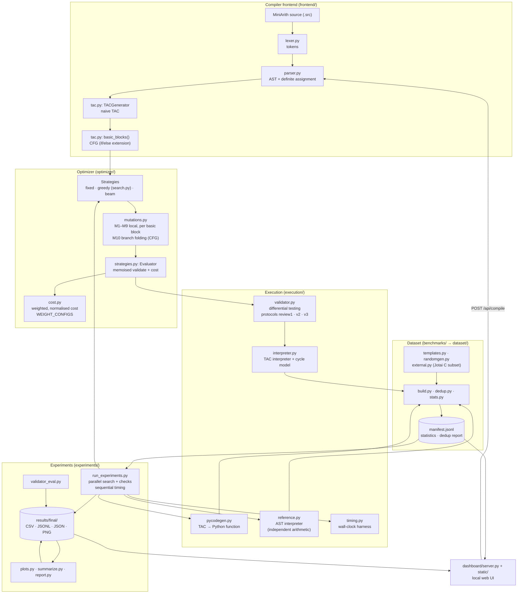
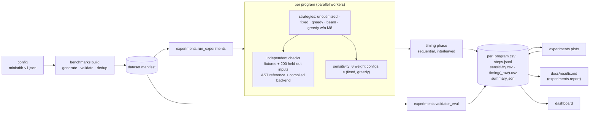
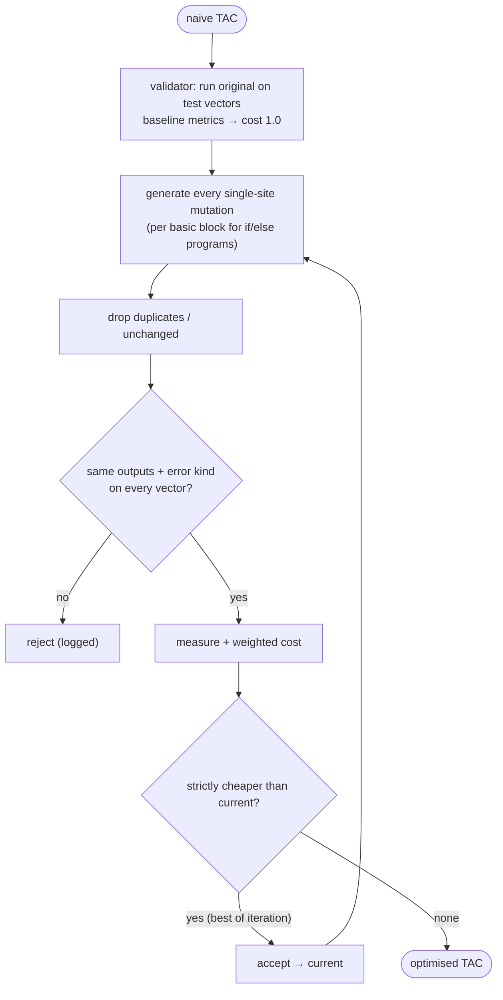

# System architecture

The system is a search-based optimiser for three-address code (TAC). It takes a MiniArith
program, compiles it to deliberately naive TAC, and improves that TAC with **mutation
operators** (rewrite rules). Each operator only *proposes* a change. A **validator** rejects
any candidate whose observable behaviour differs from the original program, where observable
behaviour means the printed values and the runtime error, if any. A **search strategy** then
keeps the cheapest valid program under a weighted **cost model**.

## Components

| Module | Responsibility |
|---|---|
| `frontend/lexer.py` | Tokenises MiniArith and rejects `t<digits>` names, which are reserved for temporaries. |
| `frontend/parser.py` | Recursive-descent parser that produces an AST. It enforces definite assignment, so an accepted program can never read an undefined variable, including across `if/else`. |
| `frontend/tac.py` | TAC IR (`Instr`). It holds the naive generator (one temporary per operator, one copy per assignment), the TAC text parser, basic blocks, the CFG, and canonical (alpha-renamed) TAC for deduplication. |
| `execution/interpreter.py` | Executes TAC and counts **simulated cycles**. An undefined variable or jump target is reported as a runtime error, never a crash. |
| `execution/reference.py` | The semantic oracle. It evaluates the AST directly, with its own C-style arithmetic, and imports nothing from the TAC side. This independence is checked by a unit test. |
| `execution/pycodegen.py` | Compiles straight-line TAC to a Python function. It serves as a second executor for checks and as the second timing backend. |
| `execution/validator.py` | Differential testing against the original program. Three protocols: `review1` (25 seeded vectors, the default), `v2` (+ structured vectors) and `v3` (+ coverage vectors; used by the final experiments and the dashboard). |
| `execution/timing.py` | Wall-clock timing: warm-up runs, interleaved rotating order, GC disabled, and raw samples returned. |
| `optimizer/mutations.py` | Operators M1–M10 and the unsafe demo operator MX. `generate_mutations` applies local operators one basic block at a time. |
| `optimizer/cost.py` | Metrics and the weighted cost. The baseline weights are those of Review-1. |
| `optimizer/search.py` | Greedy best-improvement search (Review-1, unchanged apart from optional parameters). |
| `optimizer/strategies.py` | Shared `Evaluator`, plus the fixed-order pipeline, greedy wrapper and beam search. |
| `benchmarks/*` | Dataset generators, extraction, build, deduplication and statistics (see `dataset/README.md`). |
| `experiments/*` | Experiment runner, aggregation, validator self-evaluation, plots and report generation. |
| `dashboard/*` | Local web dashboard built on the standard library HTTP server, with vanilla JS and no CDN. |
| `reproduce.py` | One command for the whole verification and experiment pipeline. |

## End-to-end workflow

## Search loop (greedy; the other strategies differ only in step 4)

- **fixed:** applies the first valid candidate of each operator in `FIXED_ORDER`,
  regardless of cost, until a fixpoint is reached. It then runs an M8 scheduling pass that
  accepts only swaps that lower simulated cycles.
- **greedy:** at each step, picks the best strictly improving candidate.
- **beam:** keeps the `width` cheapest distinct valid programs at each depth, and stops after
  `patience` depths without a new best program.

## Control-flow extension (staged)

`if (cond) { … } else { … }` compiles to `ifz c goto L`, `goto L` and `label L`.
`basic_blocks()` splits the program at labels and after jumps, and links the blocks into a
CFG. Every local operator sees **one block body plus its terminating jump**. It never sees a
label. It also receives a conservative `live_out` set: every variable read anywhere outside
that slice. if/else code is acyclic, so this set over-approximates true liveness, and
dead-code decisions stay sound. M8 never moves code across a label or jump. M10 folds
`ifz <constant>`, and in the same step removes unreachable blocks, redundant jumps and
unused labels. Straight-line programs form a single block with an empty `live_out`, which
is exactly the Review-1 code path. A test confirms that Review-1 results reproduce byte for
byte, apart from timing fields.

**Status:** implemented and tested (exhaustive operator soundness on control-flow programs,
property tests and fuzzing). It is **not** part of the benchmark dataset, which is
straight-line only. There are no loops, so no cyclic CFG or iterative data-flow analysis.
