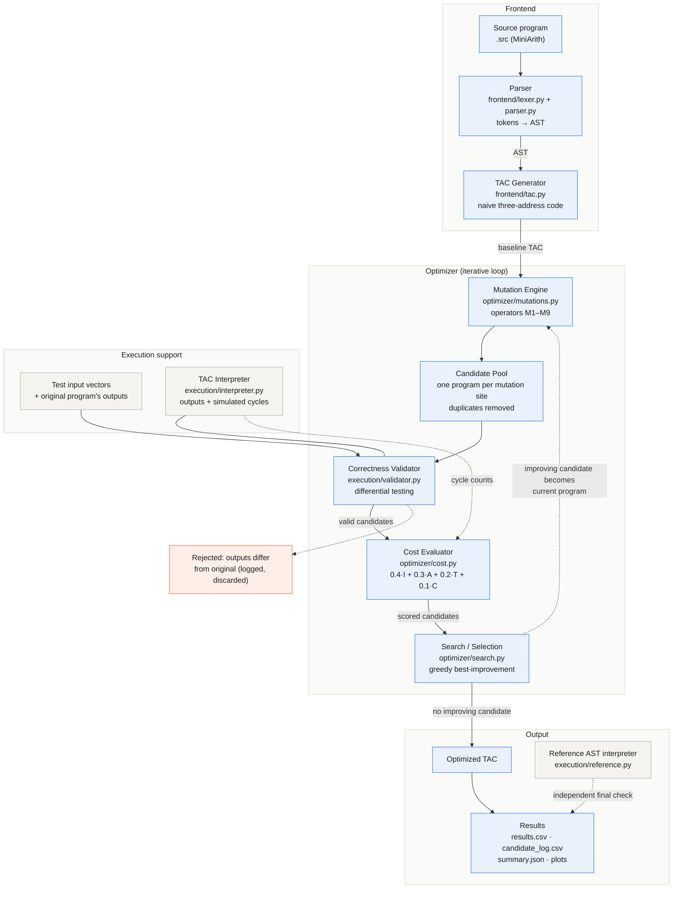
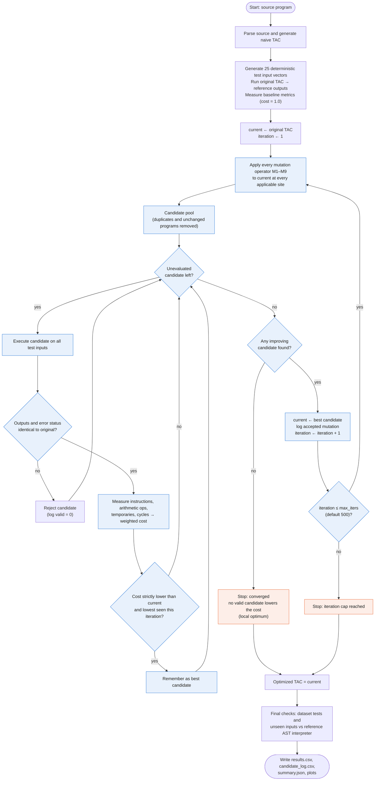

> **Historical (Review-1) document.** It describes the Review-1 prototype and is kept for provenance.
> The current system is described in [architecture.md](architecture.md), [methodology.md](methodology.md) and
> [results.md](results.md); [architecture.mmd](architecture.mmd) now shows the current architecture.

# Automated Mutation-Based Compiler Code Optimization: Project Overview

This prototype optimises **three-address code (TAC)** by search rather than a fixed pass order.
Rewrite rules ("mutation operators") propose small changes to the program. Every proposal is run
on test inputs and kept only if its observable behaviour (printed values and runtime errors) is
identical to the original. A greedy search then accepts, one change at a time, the valid proposal
that lowers a weighted cost most, and stops when nothing lowers it further. The input language,
MiniArith, is a small straight-line integer language with `input`, assignment, `print` and
`+ - * / %`, chosen so that the full pipeline is working for Review 1.

## 1. System architecture

Source: [`architecture.mmd`](architecture.mmd)



## 2. End-to-end workflow

The loop repeats until one of two stopping conditions holds: **(a)** no valid candidate lowers the
cost (convergence to a local optimum; this is how every benchmark run so far has ended), or
**(b)** the iteration cap `max_iters` (default 500) is reached.

Source: [`workflow.mmd`](workflow.mmd)



## 3. Modules

### `frontend/`: source to TAC
| Module | Role |
|---|---|
| `lexer.py` | Turns source text into tokens (numbers, identifiers, operators, `input`/`print`) and rejects bad characters and names reserved for temporaries (`t1`, `t2`, …). |
| `parser.py` | Recursive-descent parser that builds an AST using standard operator precedence, and reports syntax errors and use of undefined variables. |
| `tac.py` | Defines the TAC instruction format and a deliberately naive generator: every operator result gets a fresh temporary and every assignment becomes a copy. This leaves redundancy for the optimiser to find. It also parses TAC text, which the tests use. |

### `execution/`: running and checking programs
| Module | Role |
|---|---|
| `interpreter.py` | Executes TAC with C-style integer division and counts **simulated cycles** (`*` = 3, `/ %` = 10, others = 1, plus a 1-cycle stall when an instruction uses the previous instruction's result). The cycle count gives a deterministic stand-in for execution time. |
| `validator.py` | The correctness validator. It generates 25 seeded test input vectors, records the original program's outputs, and accepts a candidate only if it produces identical outputs and error status on all of them. |
| `reference.py` | An independent AST interpreter that runs the *source* directly, without TAC. It provides the dataset's expected outputs and the final end-to-end correctness checks. |

### `optimizer/`: mutation, cost, search
| Module | Role |
|---|---|
| `mutations.py` | The mutation engine. Nine operators each return one candidate per applicable site: M1 zero-add removal, M2 one-mul removal, M3 constant folding, M4 strength reduction, M5 dead assignment removal, M6 CSE, M7 constant propagation, M8 instruction reordering, M9 copy propagation. A deliberately unsafe operator, MX, exists only for demonstrations. Operators never delete or move a division that could fail with division by zero. |
| `cost.py` | Measures instructions, arithmetic ops, distinct temporaries and mean cycles, and combines them as `0.4·I + 0.3·A + 0.2·T + 0.1·C`, each normalised by the original program's value, so the original always scores 1.0. |
| `search.py` | Greedy best-improvement search. Each round it builds the deduplicated candidate pool, validates and scores every candidate, and moves to the cheapest one only if it strictly lowers the cost; it can report every evaluated candidate for logging. |

### `benchmarks/`: inputs
| Module | Role |
|---|---|
| `b1`–`b7 *.src` | Seven hand-written programs. Five target particular operators, and two are stress cases for variable redefinition and division by zero. |
| `generate_dataset.py` | Builds the 15-program Review-1 dataset from seeded templates in six categories, with 3–5 test inputs each and expected outputs taken from the reference interpreter. The same seed always yields a byte-identical `dataset/review1_dataset.json`. |

### `visualization/`: figures
| Module | Role |
|---|---|
| `plots.py` | Draws the convergence, before/after metrics and operator-usage plots for the hand-written benchmarks run by `main.py`. |
| `dataset_report.py` | Reads *only* `results.csv` and `candidate_log.csv`, refuses to run if they disagree, and writes the four dataset plots and `statistics.json`. |

### Entry-point scripts
| Script | Role |
|---|---|
| `main.py` | Command-line demo. For each program it prints the search trace, the original and optimised TAC side by side, and a metrics table, then saves per-benchmark results and plots (`--unsafe` demonstrates validator rejections). |
| `run_dataset.py` | Optimises all 15 dataset programs, checks each result against the dataset tests and 300 unseen inputs, and writes `results.csv`, `candidate_log.csv` and `summary.json`. |
| `verify_pipeline.py` | Stage-by-stage check of every benchmark: TAC against the reference interpreter, each operator in isolation, the validator against deliberately broken programs, cost recomputed by hand, and the full search. |

### `tests/`: automated tests
| Module | Role |
|---|---|
| `test_frontend.py` | Lexer and parser error handling, operator precedence, C division semantics, and the TAC round trip. |
| `test_mutations.py` | Exact expected output for every operator, including cases where it must *not* fire (redefinitions, I/O order, divisions that could fail). |
| `test_optimizer.py` | Validator accept/reject, cost normalisation, cycle model, search monotonicity and correctness on every benchmark, the unsafe-operator demo, and a small fuzz run. |
| `test_dataset.py` | The dataset generates deterministically, matches the saved file, has the required shape, and its expected outputs match the compiled TAC. |
| `fuzz.py` | Random-program fuzzer comparing optimised output with the reference interpreter. It found, and now guards against, the division-by-zero soundness bug in M5/M8. |

### `results/`: outputs (generated, never edited by hand)
`results.csv` (one row per program), `candidate_log.csv` (one row per evaluated candidate),
`summary.json` and `statistics.json` (aggregates), per-benchmark TAC and traces, and `plots/`.

## 4. Reproducing everything

```
python -m benchmarks.generate_dataset        # dataset (seed 2026)
python run_dataset.py                        # optimise all 15 programs → CSV/JSON
python -m visualization.dataset_report       # statistics + 4 plots from the CSVs
python main.py                               # demo on the 7 hand-written benchmarks
python -m unittest discover -s tests -t .    # test suite
```
